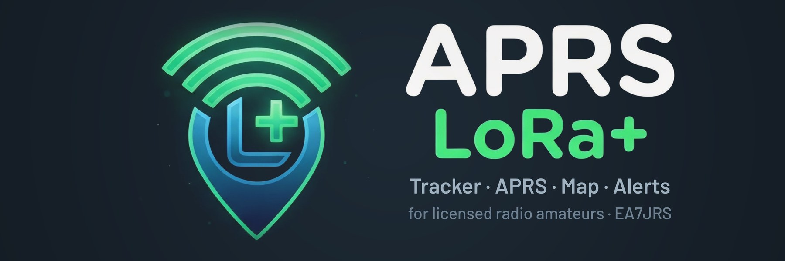

<p align="center"><a href="https://ea7jrs.github.io/APRS-LoRa-Plus/"></a></p>

# APRS LoRa+ NMEA 2000

Pasarela del tracker **APRS LoRa+** al bus **NMEA 2000** del barco: las estaciones APRS que oye el tracker salen en el plotter (Garmin GPSMAP y otros) como **blancos AIS**, y la temperatura y la humedad del HAT XIAO-LOG como datos de ambiente.

Copyright (C) 2026 Manuel - EA7JRS · GPL-3.0-or-later · versión **5.4.5** (la misma que el tracker, el rotor, la app y el gateway).

```
 Tracker APRS LoRa+ ──KISS por WiFi (TCP 8001) o por BLE──► XIAO ESP32-S3 + CAN (MCP2515) ──NMEA 2000──► plotter
                                                                │
                                                          HAT XIAO-LOG (temperatura, humedad, luz, reloj)
```

- **Blancos AIS**: posiciones APRS sin comprimir, comprimidas y Mic-E, objetos e ítems, tráfico de terceros; rumbo, velocidad y altitud. MMSI ficticio `8 MID nnnnn` (el mismo que el tracker en NMEA 0183) o el real con la etiqueta `AIS:` del perfil náutico. Las estaciones de radioaficionado (sin perfil `AIS:`) salen por defecto como **ayuda a la navegación virtual** (129041), que el plotter no vigila con la alarma de abordaje; los barcos con perfil `AIS:` van como buque clase B (129039, 129809, 129810) o A (129038, 129794). Configurable (`ais.aton`).
- **Ambiente**: 130311, 130313 y 130316 (temperatura de rango ampliado, la que prefiere el Garmin) + 130312; anemómetro de cazoletas (opcional, D3): 130306.
- **GPS del tracker** (opcional, `gps.on`): si el barco no tiene otra antena GPS en el bus, emite la posición del tracker como 129025 / 129026 / 129029 (posición, COG/SOG, GNSS con hora). El Garmin la usa para posición, rumbo, velocidad, hora y, con el instrumento de viento, el viento real.
- **Tiempo de internet de la app** (opcional, `gps.wx`): la app puede balizar el tiempo de internet (viento, presión, temperatura) bajo el indicativo del barco; sin sensores a bordo, la pasarela lo emite como 130306 / 130314 / 130316. Así, sin tracker, la app sola puede dar al plotter posición, hora y tiempo.
- **Del bus**: posición del barco (filtro de distancia) y hora (al reloj del HAT).
- **WebUI**: estado del enlace y del bus, blancos, ambiente, últimos paquetes, configuración y actualización del firmware.
- **Solo escucha**: no transmite por radio.

## Red, WebUI y claves

La pasarela trae WiFi y WebUI propios (puerto 80: `/`, `/api/status`, `/api/config`, `/update` para OTA).

| | Por defecto | Notas |
|---|---|---|
| Red WiFi propia (AP) | **`APRS-N2K`** / clave **`aprsn2000`** | `wifi.mode` 2 = punto de acceso; abre `http://192.168.4.1`. La clave del AP necesita ≥ 8 caracteres. |
| WiFi cliente | — | `wifi.mode` 1: se une a la red del barco (`wifi.ssid`/`wifi.pass`); si no entra en 30 s levanta el AP de rescate. |
| Clave de la WebUI | **`123456`** | El mismo PIN de control del ecosistema APRS LoRa+ (tracker, plotter, app). HTTP Basic, usuario `admin`; solo se pide para **cambiar** la configuración o actualizar. Déjala vacía para no pedir clave; **cámbiala** si la pasarela es accesible desde la red del barco. |

Nombre común `APRS-N2K` para la red/AP, mDNS (`APRS-N2K.local`) y Bluetooth. Detalle en el [manual](docs/MANUAL_ES.md#4-primer-arranque).

**Hora**: la toma del GPS/plotter del bus NMEA 2000 (PGN 126992 o 129029) y la guarda en el reloj RTC del HAT XIAO-LOG. En modo cliente WiFi, además sincroniza por **NTP `ntp.roa.es`** (reserva; el GPS del bus manda 6 h sobre NTP). No necesita hora precisa para funcionar: los blancos AIS salen igual.

## Documentación

- **Manual de usuario**: [español](docs/MANUAL_ES.md) · [English](docs/MANUAL_EN.md)
- **Guía rápida**: [español](docs/QUICKSTART_ES.md) · [English](docs/QUICKSTART_EN.md)
- [docs/HARDWARE.md](docs/HARDWARE.md): material, pines, **arreglo del pin D10 del XIAO-LOG**, conexión al bus NMEA 2000

## Compilar

```
pio run -e xiao_esp32s3_can -t upload     # firmware (PlatformIO)
make -C test_host run                     # pruebas del núcleo en el PC
```

## Estructura

```
lib/GateCore/src/   núcleo en C++ sin Arduino: KISS, AX.25, APRS (gc_aprs.h), tabla AIS y MMSI (nmea0183, ais_vessel: los del tracker), motor (gc_gate.h)
src/                firmware: config, tracker_link (BLE / TCP), n2k (NMEA 2000), loghat (XIAO-LOG), net (WiFi, WebUI)
test_host/          pruebas en el PC
```

Librerías: NMEA2000 y NMEA2000_mcp (Timo Lappalainen, MIT), CAN_BUS_Shield (Seeed Studio, MIT), NimBLE-Arduino, ArduinoJson.

## Referencia de formatos: CANboat

Los PGN salen de la librería NMEA2000 de ttlappalainen; las unidades y los campos que se le pasan se han contrastado con la base de datos de **[CANboat](https://canboat.github.io/canboat/)** v9.2.0 (Apache-2.0). `canboat.dbc` (en esa misma página) sirve para ver el bus con SavvyCAN o Wireshark al depurar.
